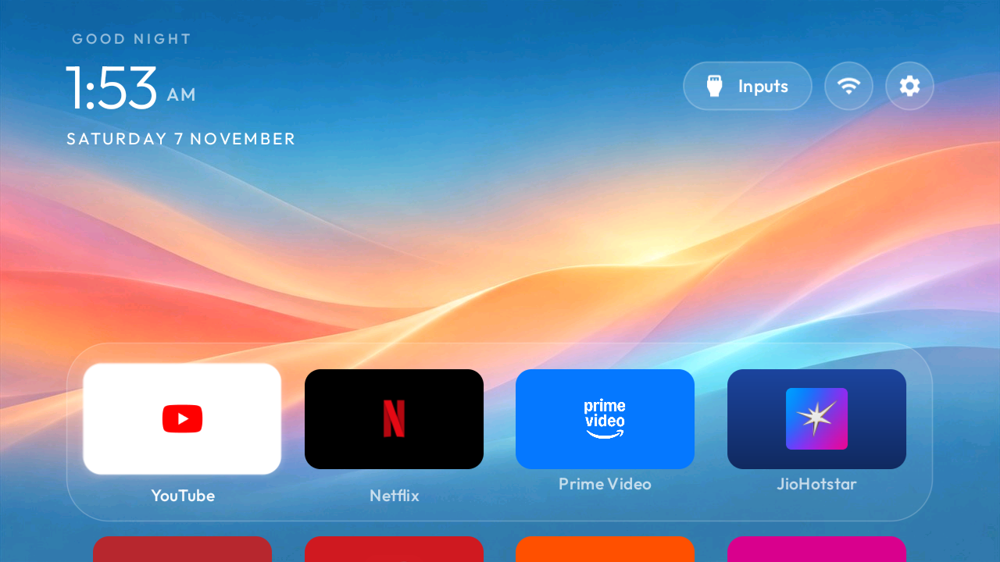
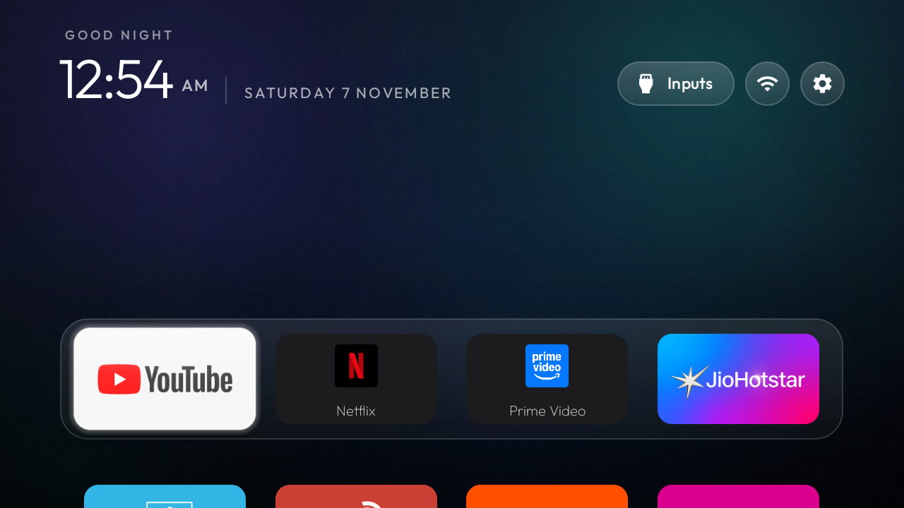
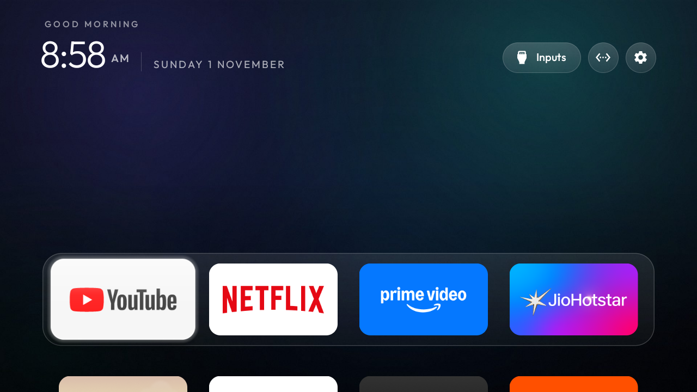

# Clean Screen Setups

Bright projector Home, a quiet TV interface, and reversible cleanup profiles for two tested Android devices.



This is a companion to [Gathin23/cleanyourtv](https://github.com/Gathin23/cleanyourtv). It packages the device configurations, themes, photographs, setup notes and measured results from a real TCL TV and Portronics projector. The launcher, Android tools and Photos screensaver come from CleanYourTV; their source is pinned in the [`upstream`](upstream) submodule.

## What is included

| Feature | Portronics Beem 440 | TCL UnionTV |
|---|---|---|
| Home appearance | Bright **Projector Sunrise Fast**, plus Cinematic | Cinematic |
| Dock order | YouTube → Netflix → Prime Video → Hotstar | YouTube → Netflix → Prime Video → Hotstar |
| Cleanup | Two audited telemetry/ad packages; one optional old screensaver SDK | Eight telemetry, recommendation and retail-demo packages |
| Screensaver | Four credited landscape photographs | Existing system screensaver retained |
| Original controls | Native projector settings, Bluetooth, USB input and HDMI retained | TV inputs, HDMI audio, voice, casting and updates retained |
| Recovery | Fresh local backup and reversible package changes | Fresh local backup and reversible package changes |

No phone remote, accessibility key helper, live wallpaper, root access or firmware modification is part of these profiles.

## Tested hardware

| Profile | Android | Tested firmware |
|---|---|---|
| [Portronics Beem 440](profiles/portronics-beem-440) | 11 / API 30 | `UI_Veng.projector.20250321.160324` |
| [TCL UnionTV](profiles/tcl-uniontv) | 9 / API 28 | `V8-R41KT01-LF1V343` |

The Beem has 1 GB RAM and a native 1280 × 720 display. Its Android model identifies as `adt3`; matching that generic name alone is insufficient. Package lists and stock controls can differ between firmware revisions. Read the [device notes](docs/DEVICES.md) before applying a profile.

## Start here

```powershell
git clone --recurse-submodules https://github.com/tirthvohera9/clean-screen-setups.git
cd clean-screen-setups
```

1. Initialize the source with submodules, or run `git submodule update --init --recursive` if you cloned without them.
2. Follow the [setup guide](docs/SETUP.md) to prepare the build tools, confirm your device and make a private backup.
3. Build the matching launcher from source, apply its theme, and test the physical remote and sound.
4. Apply only the cleanup you have reviewed. The Photos screensaver is a separate optional step.
5. Turn debugging off when finished and verify the connection is closed.

The Windows wrappers are in [`scripts/`](scripts). They require you to supply your own device address. No prebuilt APK, personal backup or debugging key is distributed. To work with a coding agent, use the [setup prompt](PROMPT.md).

## Why the brighter projector theme?

The dark Cinematic theme looked less distinct in projection. Projector Sunrise uses a bright static background, readable white labels, uniform tiles and short motion. The active wallpaper is a 65,848-byte, 1280 × 720 JPEG; the original generated image is preserved separately.



The owner checked the brighter result from the normal viewing position and confirmed the clock, labels and selected tile were clear.

## Measured results

| Beem 440 launcher measurement | Cinematic | Sunrise Fast |
|---|---:|---:|
| Memory, PSS | 55 MB | 43 MB |
| Median cold start, five starts | 907 ms | 845 ms |
| Launcher idle CPU | 0.1% | 0.1% |

These are small practical measurements, with different navigation preconditioning. They do not establish an FPS improvement, faster streaming, lower navigation latency or a reliable worst-case startup time. The Photos add-on was installed **after** these measurements. See the [method and limitations](docs/PERFORMANCE.md).

## Photos screensaver


The tested projector setup shows a different photograph every 30 seconds, starting after two idle minutes. Any key wakes it. The four photographs are above the projector's native resolution and retain their [authors, source links and licences](screensaver/CREDITS.md). They are landscape photographs selected for this setup, not Apple assets.

## TV appearance



The TCL profile keeps its television input paths, HDMI home-theatre audio, Google Assistant, casting and updates. Its dock uses the TV-specific Netflix and Prime packages; the projector uses different package IDs. The two compiled configurations are intentionally separate.

## Recovery and project scope

- [Restore the previous setup](docs/RESTORE.md)
- [What was tested, and what remains unverified](docs/DEVICES.md)
- [What stays private](docs/PRIVACY.md)
- [Credits and licences](NOTICE.md)

Cleanup disables packages; it does not uninstall them. Keep the backup and recovery record produced for **your** device. A different owner's saved state is not a restore plan for yours.

The tested upstream revision is `1937c8048672d4c322e70fe805bda1175f546716`. Updating it is a new compatibility change and needs fresh validation.

The public wrapper scripts were checked locally with parsing and offline validation. They were prepared after the device sessions ended and have not been rerun end to end on the hardware. The device results above refer to the original setup using the upstream tools.
